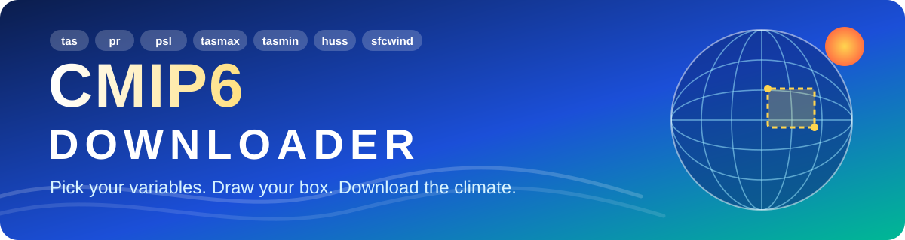
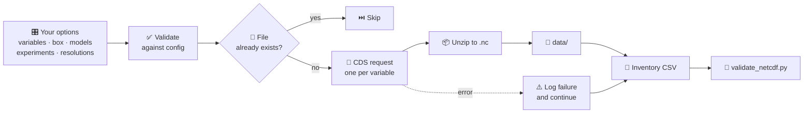

<div align="center">



### 🌍 Download CMIP6 climate projections from the Copernicus CDS — only the **variables** and **region** you need.


[**⚡ Quick start**](#-quick-start) · [**🌡️ Variables**](#️-variables) · [**🗺️ Box**](#️-choose-your-region---box) · [**🧪 Recipes**](#-recipes--click-to-expand) · [**🛟 Troubleshooting**](#-troubleshooting)

</div>

---

## ✨ Highlights

| | Feature | What you get |
|---|---|---|
| 🌡️ | **Pick variables** | Any mix of 7 variables via `--variables`, or all with `--all-variables` |
| 🗺️ | **Pick a box** | `--box MINLAT MAXLAT MINLON MAXLON` — no more mental N/W/S/E juggling |
| 🤖 | **58 models** | One model or `--all-models` |
| 🔮 | **9 experiments** | `historical` plus every SSP scenario in the config |
| ⏱️ | **Daily & monthly** | Choose one or both with `--resolutions` |
| ♻️ | **Resumable** | Existing files are skipped, so you can just re-run |
| 🧾 | **Audit trail** | Log file + CSV inventory of every success and failure |
| ✅ | **Validator** | Checks every downloaded NetCDF and writes a report |

---

## ⚡ Quick start

**1️⃣ Install**

```bash
mkdir -p /home/user/DATA/cmip6
cd /home/user/DATA/cmip6
python -m pip install --upgrade cdsapi xarray netCDF4 pandas
```

**2️⃣ Set up your CDS account** 🔑

- Configure API credentials: <https://cds.climate.copernicus.eu/how-to-api>
- Accept the dataset terms: <https://cds.climate.copernicus.eu/datasets/projections-cmip6>

**3️⃣ Copy the project files** into `/home/user/DATA/cmip6/`

```text
/home/user/DATA/cmip6/
├── config/
│   └── cmip6_config.json     ⚙️  variables, models, experiments, default area
├── scripts/
│   ├── download_cmip6.py     ⬇️  the downloader
│   └── validate_netcdf.py    ✅  the validator
├── data/                     📦  downloaded NetCDF (created automatically)
├── logs/                     📜  cmip6_download.log
└── metadata/                 🧾  download_inventory.csv, validation report
```

**4️⃣ Run your first download** 🚀

```bash
python scripts/download_cmip6.py \
  --models cesm2_fv2 \
  --experiments historical \
  --resolutions monthly \
  --variables tas pr \
  --box 2 16 32 49
```

> 💡 Not sure what's available? Run `python scripts/download_cmip6.py --list-variables` or `--help`.

---

## 🌡️ Variables

Use the **short name** or the **full CDS name** (case-insensitive). Default when `--variables` is omitted: `pr`.

| Short | Variable | CDS name |
|:---:|---|---|
| 🌀 `psl` | Sea level pressure | `sea_level_pressure` |
| 🌧️ `pr` | Precipitation | `precipitation` |
| 🔥 `tasmax` | Daily maximum near-surface air temperature | `daily_maximum_near_surface_air_temperature` |
| ❄️ `tasmin` | Daily minimum near-surface air temperature | `daily_minimum_near_surface_air_temperature` |
| 🌡️ `tas` | Near-surface air temperature | `near_surface_air_temperature` |
| 💧 `huss` | Near-surface specific humidity | `near_surface_specific_humidity` |
| 💨 `sfcwind` | Near-surface wind speed | `near_surface_wind_speed` |

```bash
--variables tas pr                      # a few
--variables near_surface_wind_speed     # full CDS name works too
--all-variables                         # everything
```

---

## 🗺️ Choose your region: `--box`

```text
                     MAXLAT
              ┌───────────────────┐
              │                   │
     MINLON   │      🎯 your      │   MAXLON
              │       region      │
              │                   │
              └───────────────────┘
                     MINLAT

         --box  MINLAT  MAXLAT  MINLON  MAXLON
```

```bash
--box 2 16 32 49        # lat 2°→16°, lon 32°→49°
```

- Order is **MINLAT MAXLAT MINLON MAXLON**; the script converts it to the CDS `[North, West, South, East]` format.
- No `--box`? The default `area` in `config/cmip6_config.json` is used: `[16, 32, 2, 49]`.
- Rules checked for you: `-90 ≤ MINLAT < MAXLAT ≤ 90` and `-180 ≤ MINLON < MAXLON ≤ 360`.
- 🌐 Boxes crossing the dateline aren't supported; use 0–360 longitudes for such a region.

---

## 🧭 How it works



Jobs run in the order **resolution → experiment → model → variable**. A failed job never stops the run.

---

## 🧪 Recipes — click to expand

<details>
<summary><b>🌡️ One model, a few variables, my region</b></summary>

```bash
python scripts/download_cmip6.py --models cesm2_fv2 --experiments historical \
  --resolutions monthly --variables tas pr psl --box 2 16 32 49
```
</details>

<details>
<summary><b>🔮 Future scenarios (SSPs)</b></summary>

```bash
python scripts/download_cmip6.py --models cesm2_fv2 \
  --experiments ssp1_2_6 ssp2_4_5 ssp5_8_5 \
  --resolutions monthly --variables tas pr --box 2 16 32 49
```
</details>

<details>
<summary><b>🌈 Every variable, one model, daily data</b></summary>

```bash
python scripts/download_cmip6.py --models cesm2_fv2 --all-variables --resolutions daily
```
</details>

<details>
<summary><b>🤝 Multi-model ensemble</b></summary>

```bash
python scripts/download_cmip6.py --models cesm2_fv2 miroc6 mpi_esm1_2_lr \
  --experiments historical ssp2_4_5 --resolutions monthly --variables tas pr
```
</details>

<details>
<summary><b>🐘 The whole thing (very large — test one model first!)</b></summary>

```bash
python scripts/download_cmip6.py --all-models --all-variables \
  --experiments historical --resolutions monthly --box 2 16 32 49
```
</details>

<details>
<summary><b>✅ Validate what you downloaded</b></summary>

```bash
python scripts/validate_netcdf.py
```
Scans `data/` and writes `metadata/netcdf_validation_report.csv` with variables, dimensions, time range, coordinate names and file size for each file.
</details>

---

## 🏷️ Output naming

Variable and box are part of every filename, so different requests never overwrite or skip each other.

```text
cesm2_fv2 _ tas _ lat2to16_lon32to49 _ 19800101 _ 20141231 .nc
   │          │          │                 │          │
 model    variable      box             start       end
```

Folder layout: `data/<resolution>/<experiment>/…` (negative values in the box tag appear as `m`, e.g. `m5` = −5).

If CDS returns several NetCDF files, they are saved with `_part01.nc`, `_part02.nc`, … suffixes.

<details>
<summary><b>🧾 Inventory CSV columns</b></summary>

`date, model, experiment, resolution, variable, area_NWSE, start_year, end_year, status, output`

`status` is `SUCCESS` or `FAILED: <reason>`. An inventory from an older version of this tool is renamed (not overwritten).
</details>

---

## 🔮 Experiments & time ranges

| Experiment | Years |
|---|---|
| 📜 `historical` | 1980–2014 |
| 🌱 `ssp1_1_9` · `ssp1_2_6` | 2015–2100 |
| 🌤️ `ssp2_4_5` · `ssp4_3_4` · `ssp4_6_0` | 2015–2100 |
| 🔥 `ssp3_7_0` · `ssp5_3_4os` · `ssp5_8_5` | 2015–2100 |

Edit these in `config/cmip6_config.json`.

<details>
<summary><b>🤖 All 58 configured models</b></summary>

`access_cm2` `access_esm1_5` `awi_cm_1_1_mr` `awi_esm_1_1_lr` `bcc_csm2_mr` `bcc_esm1` `cams_csm1_0` `canesm5` `canesm5_canoe` `cesm2` `cesm2_fv2` `cesm2_waccm` `cesm2_waccm_fv2` `ciesm` `cmcc_cm2_hr4` `cmcc_cm2_sr5` `cmcc_esm2` `cnrm_cm6_1` `cnrm_cm6_1_hr` `cnrm_esm2_1` `e3sm_1_0` `e3sm_1_1` `e3sm_1_1_eca` `ec_earth3` `ec_earth3_aerchem` `ec_earth3_cc` `ec_earth3_veg` `ec_earth3_veg_lr` `fgoals_f3_l` `fgoals_g3` `fio_esm_2_0` `gfdl_esm4` `giss_e2_1_g` `giss_e2_1_h` `hadgem3_gc31_ll` `hadgem3_gc31_mm` `iitm_esm` `inm_cm4_8` `inm_cm5_0` `ipsl_cm5a2_inca` `ipsl_cm6a_lr` `kace_1_0_g` `kiost_esm` `mcm_ua_1_0` `miroc6` `miroc_es2h` `miroc_es2l` `mpi_esm_1_2_ham` `mpi_esm1_2_hr` `mpi_esm1_2_lr` `mri_esm2_0` `nesm3` `norcp1` `noresm2_lm` `noresm2_mm` `sam0_unicon` `taiesm1` `ukesm1_0_ll`
</details>

---

## 🛟 Troubleshooting

<details>
<summary><b>❌ A job FAILED in the inventory</b></summary>

CDS availability differs by model, experiment, variable and temporal resolution, and not every combination exists. Check the reason in `metadata/download_inventory.csv` and `logs/cmip6_download.log`, then compare against the live dataset form: <https://cds.climate.copernicus.eu/datasets/projections-cmip6>
</details>

<details>
<summary><b>🔑 Authentication / licence errors</b></summary>

Make sure your CDS API credentials are configured and that you accepted the terms on the dataset page.
</details>

<details>
<summary><b>🏷️ "Model not listed in config"</b></summary>

CDS API identifiers can differ from the names shown in the web form. Use the identifiers from the model list above, or add new ones to `config/cmip6_config.json`.
</details>

<details>
<summary><b>⏳ It's slow</b></summary>

Requests are queued by CDS and each variable is a separate request. Start small (one model, one variable, one experiment), and use `--box` to keep files light.
</details>

<details>
<summary><b>➕ I want to add another variable</b></summary>

Add an entry under `"variables"` in `config/cmip6_config.json`:

```json
"mykey": { "cds_name": "<exact CDS variable id>", "label": "Human-readable name" }
```
</details>

---

## 🔬 Before you analyse

- 🔎 Check the NetCDF **time coordinate, units, calendar, grid and variable name** before any scientific use.
- ⚖️ Units and temporal semantics can differ between variables and between daily and monthly products.
- 📦 This repo is a **downloader**, not the data. It needs internet access and your CDS credentials.

---

## ✅ Checklist

- [ ] CDS credentials configured
- [ ] Dataset terms accepted
- [ ] Files copied to `/home/user/DATA/cmip6/`
- [ ] Test run with one model and one variable
- [ ] Scale up 🚀
- [ ] Run `validate_netcdf.py`

<div align="center">

**Made for climate science 🌍 · Data from the Copernicus Climate Data Store**

</div>
# CMIP6DOWNLOADER
# CMIP6DOWNLOADER
